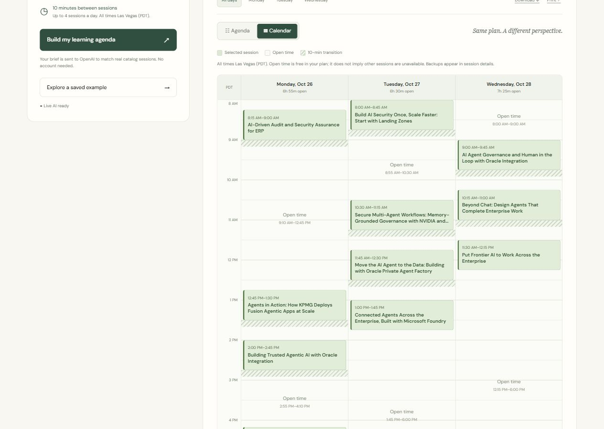

# My AI World 26

A minimal conference planner: tell it your professional background, up to three learning goals, and attending days. Live AI ranks verified Oracle AI World 2026 catalog entries. Scheduling code builds a non-overlapping agenda with a 10-minute transition buffer and up to four sessions per day. Each recommendation includes an explanation, exact catalog evidence, room, time, and official source link. Compatible backup sessions are shown when available.

Built for the Oracle AI World Hackathon. See [the submission brief](SUBMISSION.md) for the problem, target attendee, demo script, and known limitations, and [verification results](evidence/results.md) for the recorded checks.

**Live demo:** https://my-ai-world-26.vercel.app/ — no login required. The public production endpoint passed a real AI request and independent catalog, timing, and backup checks. See [deployment evidence](evidence/vercel-eval.json).



## Run locally

Requires Node.js 24. No runtime packages or build step are needed.

```sh
git clone https://github.com/matronesPublic/OracleAIWorldTable10Hackathon.git
cd OracleAIWorldTable10Hackathon
```

1. Create `.env.local` beside this README with `OPENAI_API_KEY=...` and, optionally, `OPENAI_MODEL=gpt-6-luna`. Select a model available to your API account; the supplied hackathon account exposes this model.
2. Run `npm start` or `node server.mjs`.
3. Open http://127.0.0.1:3000.

This workspace's local server also recognizes the user-created credentials file outside the app directory. That file is not part of the project or deployment.

## Demo

1. Choose **AI application developer**.
2. Keep Monday–Wednesday selected and review the editable goals.
3. Select **Build my learning agenda**. Generation usually takes 25–40 seconds.
4. Show the goal coverage, day filters, catalog evidence, and backup suggestions. Switch between **Agenda** and **Calendar** to see time blocks, free time, and transition buffers. Select a calendar block to open its details and backup.
5. Download the agenda.

**Explore a saved example** loads a verified real AI response without another model call. It is explicitly labeled as a saved example. It is not a new customized response to edited inputs.

## Data and seat availability

- Source: https://reg.rf.oracle.com/flow/oracle/oaiw26/catalog/page/catalog
- Snapshot: 764 scheduled public entries, captured October 25, 2026. The JSON records the precise capture time.
- Times display in **America/Los_Angeles**, the conference's Las Vegas timezone (PDT during the event), regardless of the viewer's timezone.
- Room capacity appears in the public data, but remaining seats do not. The app never treats capacity as remaining availability.
- Live generation excludes sessions that have already started. The saved example is a historical demonstration and remains viewable after those times pass.
- Paid Oracle University training, hackathons, and ancillary events are excluded from recommendations because this MVP does not establish attendance eligibility for them.
- A backup is verified as a **single replacement** for its primary. Simultaneous replacement by several backups is not validated.
- The catalog can change. The app links to the official catalog for current room details and access requirements. It does not reserve seats or verify attendance or learning mastery.

## Architecture

- `public/`: static, responsive web app and verified session snapshot.
- `public/calendar.mjs`: Las Vegas time conversion and calendar segments derived from the same primary agenda. Open time means unscheduled time in this plan. On small screens the days scroll horizontally inside the calendar; printing uses the complete agenda.
- `api/plan.mjs`: Vercel-compatible server function. The API key stays server-side.
- `lib/ai.mjs`: strict structured-output AI ranking. IDs are restricted to retrieved candidates. The model selects a numbered source excerpt; code supplies the original quote. Score dimensions must match the number of goals. Invalid suggestions are individually excluded, preserving verified ones; a wholly invalid response remains an explicit error.
- `lib/planner.mjs`: input validation, balanced lexical retrieval (up to 72 candidates), deterministic schedule search, duplicate prevention, backups, and goal coverage.
- `server.mjs`: a small local HTTP adapter for the same API handlers.

The agenda is a best-fit recommendation over shortlisted sessions, not a guarantee of global optimality. Goal support scores are model judgments; time and evidence constraints are verified by code. The API has a short request cache and a best-effort per-process demo request limit. There is no user management or persistent profile storage.

## Checks and evals

```sh
npm test
npm run eval
node tests/negative-eval.mjs
node tests/fusion-admin-eval.mjs
node tests/deployed-eval.mjs https://my-ai-world-26.vercel.app
```

Start the server before running live evals. Live evals call the configured AI provider and incur API usage. Set `APP_URL` to run them against a deployment. `evidence/` contains actual reports. Independent checks compare source details and quotes, test every backup replacement, enforce days and transition times, and check duplicate sessions and daily limits.

Recommendation quality rubric: relevance to the goal, fit for professional experience, specificity of explanation, source support, and agenda usefulness; review each on a 1–5 scale. The three fixed technical personas are small acceptance fixtures, not proof of recommendation quality for all professions.

## Deploy to Vercel

1. Sign in with `vercel login`.
2. Deploy this directory using `vercel deploy`.
3. Set `OPENAI_API_KEY` and `OPENAI_MODEL` as server environment variables for the deployment's environment.
4. Verify `/api/status`, generate a real agenda, and check a source link before sharing the URL.

`vercel.json` configures the static directory and a 60-second function limit. `.vercelignore` excludes credentials, tests, local server code, and evidence from the upload. Do not deploy a credentials file as a public asset.

## Preserved demo

The development workspace retains separate ZIP archives of the first passing slice, verified agenda, and calendar version. They are not included in a repository clone. Git commits provide reproducible source snapshots; use `git archive HEAD` to export the checked-in app without credentials. The saved example remains available directly in the app.
